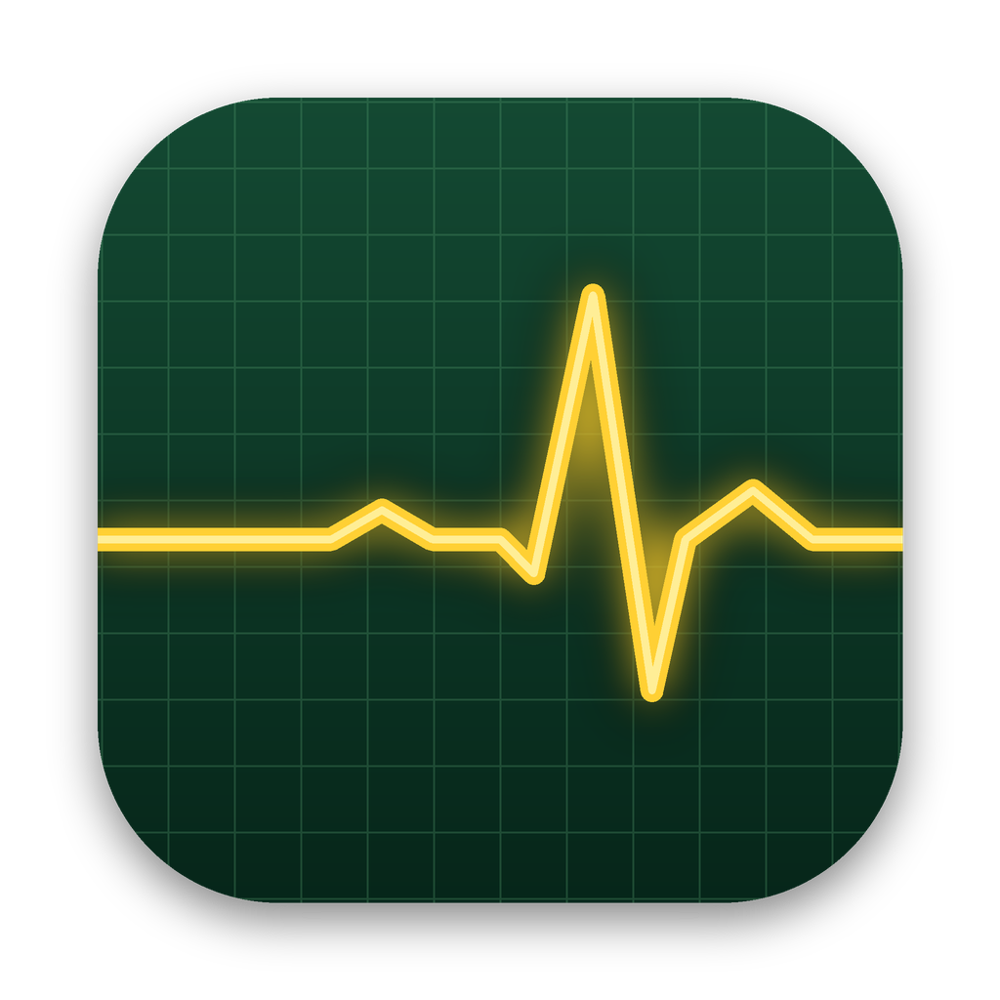

<p align="center"></p>

# CorMon

*A portrait of your Mac.* A lightweight, native SwiftUI system monitor for macOS, painted in the warm umbers, ochres and gilt frames of 19th-century academic oil painting (after Fernand Cormon). It lives in the menu bar, slides out of a hot corner, and opens a full dashboard. No dependencies, no daemons, no admin rights.

## Build & run

Requires macOS 13 (Ventura) or newer and Xcode or the Command Line Tools (`xcode-select --install`).

```bash
git clone https://github.com/jeremykjackson/CorMon.git
cd CorMon
./build.sh
open build/CorMon.app
```

To keep it: `cp -R build/CorMon.app /Applications/` (needed for **Launch at login**).
It's ad-hoc signed, not notarized, so the first launch from Finder may need right-click → **Open**.

## What's new in 2.0

- **Hot-corner glance panel**: rest the pointer in a chosen screen corner and a small framed panel shows CPU, memory, battery, disk, network, alerts and the busiest apps. It fades away when you move off it. Also available from the menu bar or ⇧⌘G.
- **Run in the background**: no Dock icon, starts without opening the dashboard, keeps measuring from the menu bar and hot corner.
- **Busiest apps**: top apps by processor (per-core %, like Activity Monitor) and by memory footprint, with helper processes folded into their app.
- **New look**: canvas texture, chiaroscuro lighting, gilt-framed panels, Baskerville titles, earth-pigment colors.
- **New icon**: a heart monitor with a yellow trace on dark green; the menu bar shows a white heart-monitor glyph (with a dot when an alert is active).

## Energy use

CorMon is built to stay out of the way:

- Cheap kernel counters (CPU, memory, network bytes, disk I/O) are read every refresh so the menu bar stays live.
- Battery, Wi-Fi, IP address and volume capacity refresh on slower schedules (5–120 s). The per-app scan runs only while a window that lists apps is open.
- With every window closed, CorMon only samples what the menu bar and health alerts need. The menu bar item redraws only when its text changes.
- The UI updates once per sample, without animations or live shadows. The glance panel's view is torn down whenever it's hidden.
- Timers use generous leeway so macOS can batch wake-ups.

If you want it lighter still, set **Refresh every** to 5 seconds in Settings.

## What it shows

| Section | Metrics |
|---|---|
| **Health summary** | Overall status, active alerts, model, chip, macOS, uptime, thermal state |
| **Processor** | Total / user / system / idle, load averages, history, per-core bars (efficiency vs performance cores) |
| **Memory** | Used %, memory pressure, app / wired / compressed, cached files, swap |
| **Busiest apps** | Top N apps by CPU and by memory, with icons and process counts |
| **Storage** | Every volume's free space, read/write throughput, SMART status; with `brew install smartmontools`: SSD life used, spare, data written/read, power-on hours, unsafe shutdowns, media errors |
| **Power** | Battery %, time remaining, health vs design capacity, cycle count, condition, temperature, voltage, battery in/out watts, system power draw, adapter, Low Power Mode |
| **Network** | Download / upload speed and history, session and since-boot totals, primary interface, local IP, Wi-Fi signal, noise, SNR, link rate |

## Customization (⌘, or "Customize…")

- **General**: run in the background, launch at login, refresh rate, °C/°F, bytes/bits
- **Hot Corner**: which corner (or off), opening delay, include busiest apps, shortcut to clear a conflicting macOS hot corner
- **Dashboard**: show/hide each section, per-core bars, number of apps listed, group helpers into apps
- **Menu Bar**: heart-monitor icon, CPU, memory, network, battery %, watts, free disk
- **Alerts**: thresholds for CPU load, swap, low disk space, battery health and temperature

## Notes

- macOS only lists Apple's own actions in System Settings › Hot Corners, so CorMon watches the corner itself (pointer position polling; no Accessibility permission needed). If macOS also has an action on that corner, both will fire. Pick a free corner or clear the macOS one.
- The busiest-apps list covers processes you own. System daemons need administrator rights to read.
- CPU/GPU die temperatures and fan speeds need private SMC interfaces on Apple Silicon, so CorMon shows the system thermal state instead.

## Project layout

```
Package.swift
build.sh                     → builds build/CorMon.app
Resources/                   Info.plist, AppIcon.icns, AppIcon.png
Tools/make_icon.py           regenerates the app icon
Sources/SystemMonitor/
  SystemMonitorApp.swift     app entry, windows, menu bar item, background mode
  Glance.swift               hot-corner watcher and at-a-glance panel
  Monitor.swift              sampling loop, history, health rules, prefs, formatting
  Collectors.swift           Mach/sysctl/IOKit/CoreWLAN readers
  Processes.swift            per-app CPU & memory sampling (libproc)
  Models.swift               metric data types
  Theme.swift                palette, type, canvas texture, gilt frames, menu bar glyph
  Components.swift           gauges, sparklines, bars, cards
  DashboardView.swift        dashboard window and section cards
  MenuBarViews.swift         menu bar label + drop-down panel
  SettingsView.swift         customization window
```
